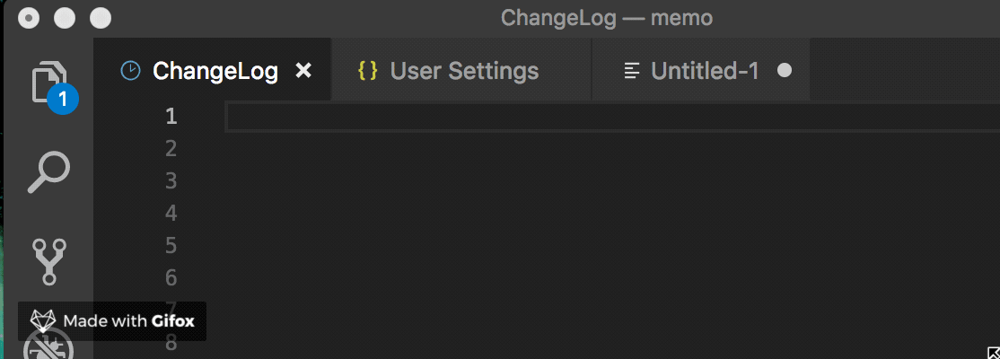
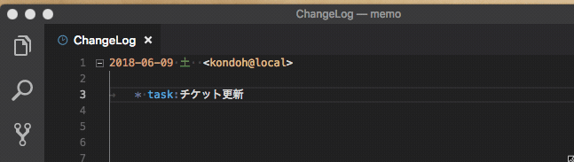

# changelog-support

Visual Studio Code extension for support Writing ChangeLog.

Note:
Rather than writing software changes, I assume that we will use the ChangeLog form for taking notes.

## Features

- ChangeLog syntax highlighting
- Insert headline (date & mail address)
- Insert item(tag) set (for weekday / weekend)
- Snippet for input item(tag and statement)
- Outline support for ChangeLog sections and items

### insert items



### snippet



## Extension Settings

This extension contributes the following settings:

- `changelog.mailAddress`: your mail address for headline
- `changelog.weekdayItems`: items(tags) you use in weekday.
- `changelog.weekendItems`: items(tags) you use in weekend.
- `changelog.dayOfWeekLang`: locale for displaying the day of week. `en`, `ja`, or `none`. default `en`.
- `changelog.outlineShowBulletItems`: show bullet item tags in Outline. default `true`.

example:
```json
"changelog.mailAddress": "your@mail.address",
"changelog.weekdayItems": [
    "task",
    "meeting",
    "development"
],
"changelog.weekendItems": [
    "driving",
    "fishing"
],
"changelog.dayOfWeekLang": "ja",
"changelog.outlineShowBulletItems": true
```

ChageLog image

```
2018-06-08 金  <kondoh@local>

	* task:チケット更新
	* meeting:仕様検討
	UI コンポーネントの振る舞い変更
	* development:
	バリデーション機能実装
```
